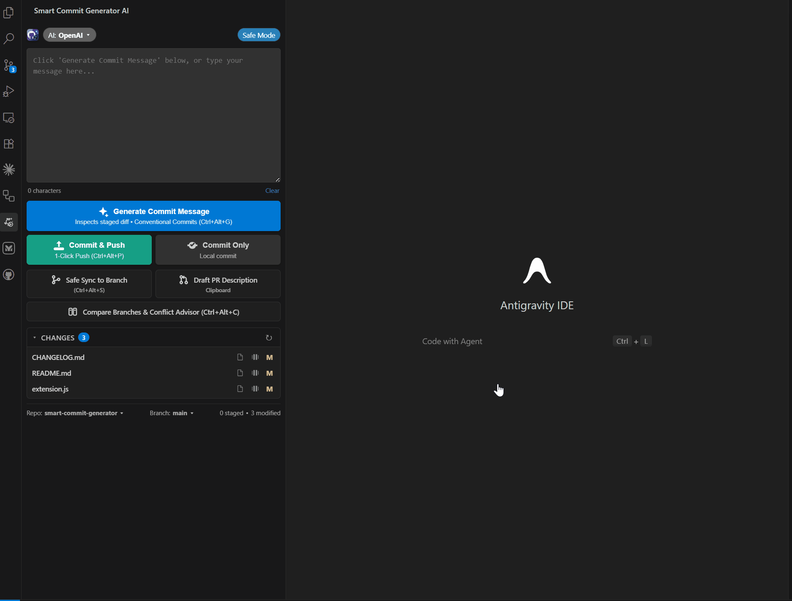
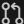

# Smart Commit Generator AI

**Fast, accurate, and context-aware Git assistant for VS Code, Cursor, and Antigravity IDE. Generate conventional commits, one-click commit & push, sync branches safely, draft comprehensive Pull Request descriptions, and resolve branch merge conflicts with OpenAI, Google Gemini, DeepSeek, Groq, Grok (xAI) & local Ollama.**

---

## Quick Demo

---

## Key Features

- **Dedicated Smart Git AI Dashboard**: Unified Activity Bar and Source Control panel with interactive commit editor, real-time character counter, and instant one-click actions.
- **Strict Diff Inspection**: Reads your exact line additions and deletions—never assumes changes from file names or unrelated code.
- **Conventional Commits**: Produces standardized headers (`feat`, `fix`, `refactor`, `perf`, `docs`, `chore`, etc.) under 72 characters, with optional bullet points for multi-part edits.
- **Interactive Changed Files Explorer**: Live list of uncommitted changed files with an active blue counter badge. Click any file or `📄` to open the file directly in the editor; click `⧉` or the status badge (`M`, `U`, `A`, `D`) to view a side-by-side diff against `HEAD`.
- **Interactive Branch Switcher**: Click `Branch: <name> ▾` in the dashboard to switch local or remote branches instantly, or create and checkout new branches on the fly.
- **Multi-Repository Switcher**: Click `Repo: <name> ▾` to switch active workspaces with zero hassle.
- **Pre-Flight Debug Artifact Protection**: Automatically scans diffs for leftover `console.log`, `debugger`, `print()`, or `var_dump()` calls before committing.
- **Fast Mode vs Safe Mode Toggle**: Switch between instant 1-click push (zero dialogs) and safe review mode with a single click.
- **Safe Branch Sync & Push (`$(git-merge)`)**: Automatically verifies zero merge conflicts in memory with `git merge-tree` before syncing and pushing changes to any target branch (e.g. `publish`, `dev`, `staging`) with auto semver bumping.
- **One-Click Commit & Push**: Stage, generate, commit, and push to your remote repository in a single click with built-in preview and safety confirmation.
- **Pull Request (PR) Generator**: Compares your working branch against `main` or `master` to generate a comprehensive markdown PR description with summary, key changes, and verification checklist.
- **Branch Compare & AI Conflict Advisor**: Dry-run merge check between any two branches. Identifies conflicts before they happen and provides production-ready merged code solutions.
- **Status Bar Launcher**: Permanent `$(sparkle) Smart Git` status bar button displaying current mode with one-click access to all tools.
- **Multi-AI Engine**: Seamlessly switch between **Google Gemini** (100% free tier, `gemini-3.8-flash`), **Groq** (free & ultra-fast LPU), **Ollama** (local, offline, zero API key), **Grok (xAI)**, **DeepSeek**, and **OpenAI**.
- **100% Private & Local**: Your API keys stay on your machine. API calls are made directly to OpenAI/Google/Groq/xAI with zero telemetry or intermediate servers.

---

## Source Control Toolbar Actions

Six dedicated action buttons are built right into your **Source Control** view header:

|   #   |                                                               Button                                                                | Action                       |       Shortcut        | Description                                                                                |
| :---: | :---------------------------------------------------------------------------------------------------------------------------------: | :--------------------------- | :-------------------: | :----------------------------------------------------------------------------------------- |
| **1** |           | **Generate Message**         | <kbd>Ctrl+Alt+G</kbd> | Inspects staged diff and populates the commit box with Conventional Commits.               |
| **2** |   | **Generate, Commit & Push**  | <kbd>Ctrl+Alt+P</kbd> | Stages modified files, generates message, commits, and pushes to remote in 1 click.        |
| **3** |       | **Safe Sync to Branch**      | <kbd>Ctrl+Alt+S</kbd> | Conflict-safe branch merge & push with auto semver release bump (e.g. `main` ➔ `publish`). |
| **4** |     | **Generate PR Description**  |           —           | Drafts full markdown Pull Request description and copies to clipboard.                     |
| **5** |     | **Compare & Security Audit** | <kbd>Ctrl+Alt+C</kbd> | Compares branches, checks conflicts, scans for leaked API keys, and offers 1-click push.   |
| **6** |  | **Toggle Fast / Safe Mode**  | <kbd>Ctrl+Alt+T</kbd> | Flips visually between Safe Mode (modal confirmation) and Fast Mode (instant push).        |

---

## Supported AI Engines & Free Options

Smart Commit Generator AI connects directly to your preferred AI model. Three of the supported providers are **100% free with zero credit card required**:

| Provider          |       Cost        | API Key Setup                                                          | Default Model             | Key Highlight                                            |
| :---------------- | :---------------: | :--------------------------------------------------------------------- | :------------------------ | :------------------------------------------------------- |
| **Google Gemini** |   **100% Free**   | Free key at [Google AI Studio](https://aistudio.google.com/app/apikey) | `gemini-3.8-flash`        | Generous free tier (1,500 requests/day, no credit card). |
| **Groq**          |   **100% Free**   | Free key at [Groq Console](https://console.groq.com)                   | `llama-3.3-70b-versatile` | Ultra-fast LPU inference (~200ms sub-second generation). |
| **Ollama**        |   **100% Free**   | Install from [ollama.com](https://ollama.com)                          | `llama3.2`                | Runs locally & offline. Zero API key, 100% private.      |
| **Grok (xAI)**    | **Pay-As-You-Go** | API key at [xAI Console](https://console.x.ai)                         | `grok-2-latest`           | Cutting-edge reasoning & coding intelligence from xAI.   |
| **DeepSeek**      |  **Ultra Cheap**  | API key at [DeepSeek Platform](https://platform.deepseek.com)          | `deepseek-chat`           | State-of-the-art coding intelligence at 90% lower cost.  |
| **OpenAI**        | **Pay-As-You-Go** | API key at [OpenAI Platform](https://platform.openai.com)              | `gpt-4o-mini`             | Industry standard GPT models.                            |

> **Tip for Ollama**: Simply run `ollama run llama3.2` in your terminal and select `"ollama"` as your provider. No API key or internet access required.

---

## Detailed Workflows

### 1. Generating a Commit Message

1. Open the **Source Control** panel (<kbd>Ctrl</kbd> + <kbd>Shift</kbd> + <kbd>G</kbd>).
2. Stage your changes (`+`), or leave them unstaged—the extension checks unstaged diffs as fallback.
3. Click the **sparkle icon** (`$(sparkle)`) on your repository header or press <kbd>Ctrl</kbd> + <kbd>Alt</kbd> + <kbd>G</kbd>.
4. Your commit message will appear in the commit input box instantly.

### 2. One-Click Commit & Push

1. Click the **cloud upload icon** (`$(cloud-upload)`) or press <kbd>Ctrl</kbd> + <kbd>Alt</kbd> + <kbd>P</kbd>.
2. In **Safe Mode**: A modal dialog previews the message and lets you confirm.
3. In **Fast Mode**: Immediately stages, commits, and pushes to remote with zero dialogs.

### 3. Safe Branch Sync & Push

1. Click the **safe branch sync icon** (`$(git-merge)`) or press <kbd>Ctrl</kbd> + <kbd>Alt</kbd> + <kbd>S</kbd>.
2. Select your target branch (e.g., `publish` to release, or `staging`).
3. The extension tests for merge conflicts in memory:
   - **Zero conflicts**: Safely switches, merges, pushes to remote, and returns to your working branch.
   - **Conflicts detected**: Aborts before touching files and opens the AI Conflict Advisor.

### 4. Pull Request Description Generator

1. Click the **git pull request icon** (`$(git-pull-request)`).
2. The AI compares your working branch against `main` or `master`.
3. Copies full Markdown PR to your clipboard and opens in a new tab.

### 5. Branch Compare, Security Audit & Direct Push

1. Click the **branch compare icon** (`$(diff)`) or press <kbd>Ctrl</kbd> + <kbd>Alt</kbd> + <kbd>C</kbd>.
2. Select any target branch to compare against.
3. Automatically runs:
   - **Merge conflict dry-run** (`git merge-tree`).
   - **Security scanner** for leaked credentials, API keys, or private tokens.
   - **AI Architecture & Risk report** opened in your editor.
4. If clean and ready, provides direct 1-click modal actions:
   - **`Sync & Push to "<branch>"`**: Automatically merges and pushes right from the comparison!
   - **`Generate PR Description`**: Formats ready-to-paste PR markdown.
   - **`Cancel`**: Closes modal and keeps report open.
5. If conflicts exist, blocks pushing and provides step-by-step resolution guidance.

---

## Configuration

Open Settings (<kbd>Ctrl</kbd> + <kbd>,</kbd>) and search for `smartCommit`:

| Setting                         | Type      | Default                    | Description                                                                       |
| :------------------------------ | :-------- | :------------------------- | :-------------------------------------------------------------------------------- |
| `smartCommit.provider`          | `string`  | `"openai"`                 | AI provider: `"openai"`, `"gemini"`, `"deepseek"`, `"groq"`, `"grok"`, or `"ollama"`. |
| `smartCommit.openaiApiKey`      | `string`  | `""`                       | OpenAI API key (`sk-proj-...`).                                                   |
| `smartCommit.geminiApiKey`      | `string`  | `""`                       | Google Gemini API key (100% free at Google AI Studio).                            |
| `smartCommit.deepseekApiKey`    | `string`  | `""`                       | DeepSeek API key (from platform.deepseek.com).                                    |
| `smartCommit.groqApiKey`        | `string`  | `""`                       | Groq API key (free at console.groq.com).                                          |
| `smartCommit.grokApiKey`        | `string`  | `""`                       | Grok (xAI) API key (from console.x.ai).                                           |
| `smartCommit.ollamaEndpoint`    | `string`  | `"http://localhost:11434"` | Local Ollama endpoint URL (runs offline, zero API key).                           |
| `smartCommit.model`             | `string`  | `""`                       | Optional model override (e.g. `gpt-4o`, `deepseek-chat`, `llama3.2`).             |
| `smartCommit.autoStage`         | `boolean` | `false`                    | Automatically stage all modified files if nothing is staged before generating.    |
| `smartCommit.confirmBeforePush` | `boolean` | `true`                     | When true: Safe Mode (shows modal). When false: Fast Mode (instant 1-click push). |
| `smartCommit.baseBranch`        | `string`  | `""`                       | Target base branch for PR generator (auto-detects `main` or `master` if empty).   |

---

## Keyboard Shortcuts

| Shortcut (Windows/Linux)                        | Shortcut (macOS)                               | Command                                           |
| :---------------------------------------------- | :--------------------------------------------- | :------------------------------------------------ |
| <kbd>Ctrl</kbd> + <kbd>Alt</kbd> + <kbd>G</kbd> | <kbd>Cmd</kbd> + <kbd>Alt</kbd> + <kbd>G</kbd> | Smart Commit: Generate Message                    |
| <kbd>Ctrl</kbd> + <kbd>Alt</kbd> + <kbd>P</kbd> | <kbd>Cmd</kbd> + <kbd>Alt</kbd> + <kbd>P</kbd> | Smart Commit: Generate, Commit & Push             |
| <kbd>Ctrl</kbd> + <kbd>Alt</kbd> + <kbd>S</kbd> | <kbd>Cmd</kbd> + <kbd>Alt</kbd> + <kbd>S</kbd> | Smart Commit: Safe Branch Sync & Push             |
| <kbd>Ctrl</kbd> + <kbd>Alt</kbd> + <kbd>C</kbd> | <kbd>Cmd</kbd> + <kbd>Alt</kbd> + <kbd>C</kbd> | Smart Commit: Compare Branches & Conflict Advisor |
| <kbd>Ctrl</kbd> + <kbd>Alt</kbd> + <kbd>T</kbd> | <kbd>Cmd</kbd> + <kbd>Alt</kbd> + <kbd>T</kbd> | Smart Commit: Toggle Fast Push / Safe Mode        |

---

## License

MIT © [Hessam Barasm Mamagani](https://github.com/Hessam-Mamagani)
